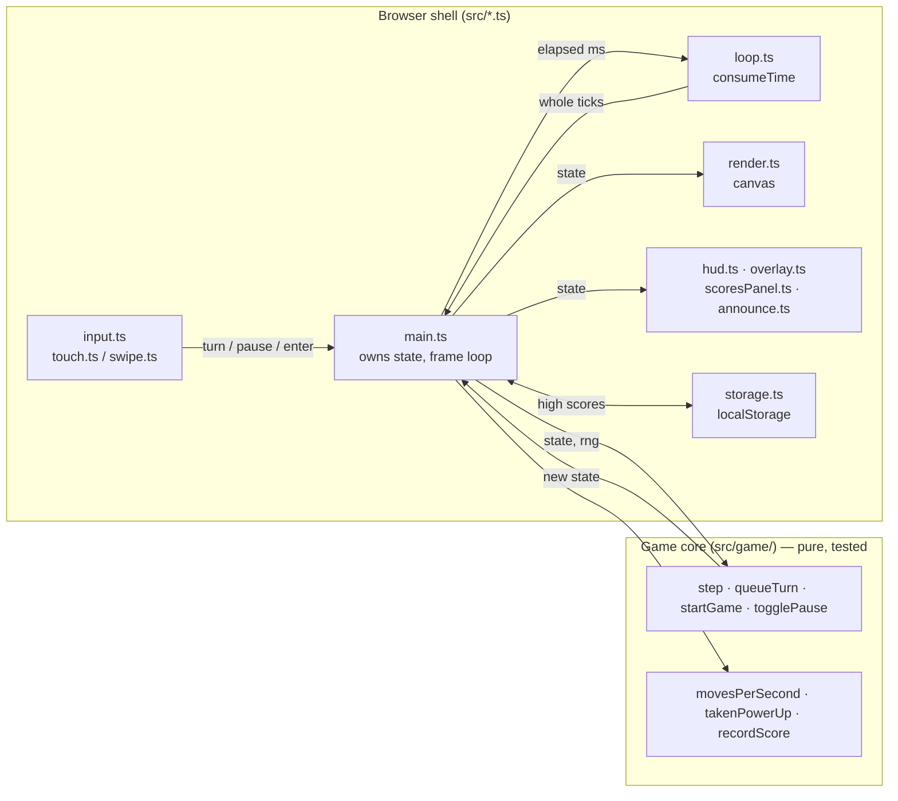
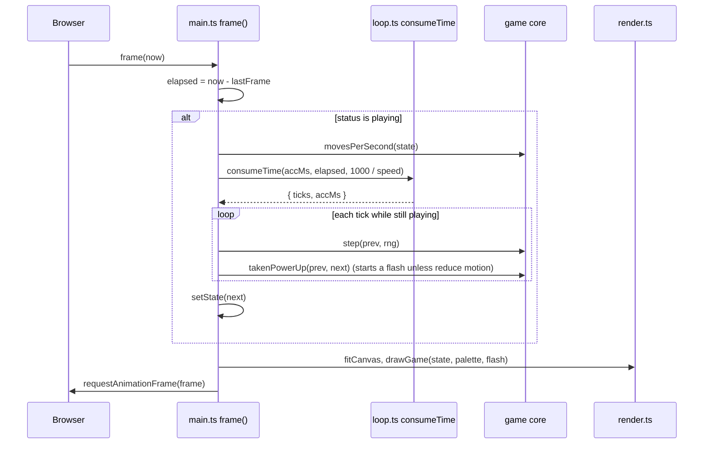
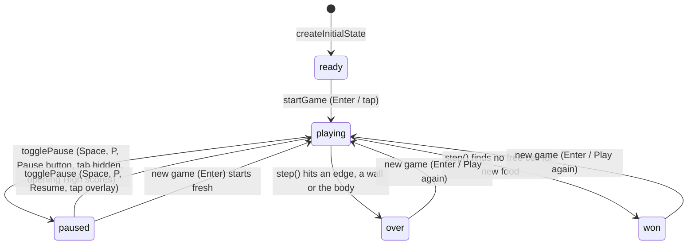

# Snake With Power-Ups: Engineering Document

| | |
| --- | --- |
| **Status** | Shipped (slice 10c) |
| **Last updated** | 2026-11-24 |
| **Source of truth for requirements** | [`snake-with-power-ups-plan.md`](../snake-with-power-ups-plan.md) |
| **Per-slice notes** | [`build-log.md`](../build-log.md) |
| **Audience** | Anyone maintaining, debugging or rebuilding the game |

This document explains how the game is put together: the architecture, every module and exported function, the exact order of the game rules, the decisions behind them, and how each part was added. It has enough detail to rebuild the app from scratch, and a [change history](#13-change-history) and [troubleshooting guide](#14-troubleshooting-guide) for tracing a break back to the slice and commit that introduced the code.

## Contents

1. [Overview](#1-overview)
2. [Tech stack and constraints](#2-tech-stack-and-constraints)
3. [Project layout](#3-project-layout)
4. [Architecture](#4-architecture)
5. [Data model](#5-data-model)
6. [Game rules and tick order](#6-game-rules-and-tick-order)
7. [Module reference: game core (`src/game/`)](#7-module-reference-game-core-srcgame)
8. [Module reference: browser shell (`src/`)](#8-module-reference-browser-shell-src)
9. [Page structure and styling](#9-page-structure-and-styling)
10. [Accessibility](#10-accessibility)
11. [Testing](#11-testing)
12. [Build and deploy](#12-build-and-deploy)
13. [Change history](#13-change-history)
14. [Troubleshooting guide](#14-troubleshooting-guide)
15. [Design decisions and trade-offs](#15-design-decisions-and-trade-offs)
16. [Recreating the app step by step](#16-recreating-the-app-step-by-step)
17. [Known limitations and future work](#17-known-limitations-and-future-work)

---

## 1. Overview

A browser snake game on a 20 × 20 grid. Eating food grows the snake and scores points; the snake speeds up as it eats; inner walls appear at 100 points; three power-ups (Boost, Slow-mo, Shrink) change speed, scoring or length. The top 5 scores are saved in the browser. It plays with a keyboard on desktop and with swipes, an on-screen pad and a Pause button on phones. There are no accounts and no server: the production build is three static files.

**Goals**

- Fair, predictable rules: the same inputs and seed always produce the same game.
- Speed that doesn't depend on the screen's refresh rate.
- Fully playable at 375 px wide with touch and at 1440 px wide with a keyboard.
- Usable with a keyboard alone, readable by screen readers, and respectful of dark mode and "reduce motion".

**Non-goals** (from the plan's "Not in this version"): sound, online leaderboards or accounts, more than one wall layout, skins, two-player mode, and any power-up beyond the three listed.

## 2. Tech stack and constraints

| Item | Choice |
| --- | --- |
| Language | TypeScript `~7.0.2`, strict mode, `noUncheckedIndexedAccess` on, no `any` |
| Build tool | Vite `^8.3.6` |
| Tests | Vitest `^5.1.1`, Node environment (no DOM) |
| UI | No framework. The board is a `<canvas>`; everything else is plain HTML and CSS |
| Runtime dependencies | None |
| Node | 24 (used locally and in CI) |

Rules that shaped the code (from [`CLAUDE.md`](../CLAUDE.md)):

1. Game rules live in `src/game/` as **pure functions with tests**. Drawing and input stay out of `src/game/`.
2. Time inside the game logic is counted in **ticks** (one snake move), never wall-clock time.
3. Randomness always comes from a **seeded generator passed in**.
4. No new dependencies without approval.

## 3. Project layout

```
.
├── .claude/commands/checkpoint.md   /checkpoint command used to log, commit and tag each slice
├── .github/workflows/deploy.yml     GitHub Pages deploy (test, build, publish)
├── docs/ENGINEERING.md              this document
├── index.html                       the single page: HUD, board, pad, live region, scores dialog
├── src/
│   ├── game/                        PURE GAME CORE: no DOM, no clocks, no Math.random
│   │   ├── types.ts                 Point, Direction, PowerUpKind, GameStatus, GameState, Rng
│   │   ├── rng.ts                   createRng (seeded mulberry32)
│   │   ├── grid.ts                  grid size, point helpers, randomFreeCell
│   │   ├── state.ts                 createInitialState
│   │   ├── turns.ts                 queueTurn (the 2-deep turn queue)
│   │   ├── status.ts                startGame, togglePause
│   │   ├── step.ts                  step: one tick of the game
│   │   ├── powerups.ts              power-up constants, scoring, effects, spawning, takenPowerUp
│   │   ├── speed.ts                 baseSpeed, movesPerSecond
│   │   ├── walls.ts                 WALL_LAYOUT, placeWalls
│   │   ├── highscores.ts            recordScore, bestScore, localDate
│   │   ├── index.ts                 public exports of the core
│   │   ├── testUtils.ts             makeState, rng, pts (tests only)
│   │   └── *.test.ts                unit tests
│   ├── main.ts                      BROWSER SHELL: wires everything, owns the state, runs the frame loop
│   ├── loop.ts                      consumeTime: fixed-timestep clock
│   ├── input.ts                     attachKeyboard
│   ├── swipe.ts                     swipeDirection (pure)
│   ├── touch.ts                     attachSwipe, attachDirectionPad, showPauseButton
│   ├── render.ts                    canvas drawing, palette, high-DPI sizing
│   ├── hud.ts                       score, best and effect bar above the board
│   ├── overlay.ts                   Ready / Paused / Game over / Win overlay
│   ├── scoresPanel.ts               high-scores dialog with confirm-to-clear
│   ├── storage.ts                   localStorage load/save with validation and backup
│   ├── announce.ts                  screen reader messages and the live-region announcer
│   ├── style.css                    theme variables (light and dark), layout, components
│   └── *.test.ts                    unit tests for the pure shell helpers
├── build-log.md                     one entry per slice: note, changes, problems, lesson, size
├── snake-with-power-ups-plan.md     the plan (requirements and slices)
├── package.json, tsconfig.json, vite.config.ts
└── README.md                        how to play, run and deploy
```

## 4. Architecture

### 4.1 Two layers: a pure core and a thin shell



- **The core** (`src/game/`) takes a `GameState` and returns a new one. It never reads the clock, the DOM or `Math.random`. Everything in it is unit-tested.
- **The shell** (`src/main.ts` and friends) owns the single mutable `state` variable, turns browser events into core calls, decides *when* ticks happen, and draws the result.

This split is what makes the rules testable and repeatable: a test can build any state, call `step()` with a seeded `rng`, and check the exact result.

### 4.2 State ownership

`main.ts` holds the only live copy of the game:

| Variable | Meaning |
| --- | --- |
| `state: GameState` | The current game. Replaced (never mutated) on every change. |
| `rng: Rng` | One seeded generator for the page's lifetime, seeded with `Date.now()` once. |
| `accMs: number` | Leftover milliseconds not yet turned into a tick. |
| `lastFrame: number` | Timestamp of the previous animation frame. |
| `flash` | The current pickup flash (`kind`, `at`, `startMs`), or `null`. |
| `highScores: HighScore[]` | The table loaded from storage at startup. |
| `madeHighScores: boolean` | Whether the game that just ended made the top 5. |
| `palette: Palette` | Canvas colors read from CSS; re-read when the color scheme changes. |

**Every state change goes through `setState(next)`.** It is the single place that:

1. resets `accMs` when the status changes (a start or resume never "catches up" on old time);
2. records the score when a game ends (`recordFinishedGame()`; the only place scores are saved);
3. announces score gains or the end of a game to screen readers;
4. moves focus to the board when play starts or resumes;
5. updates the overlay, the HUD and the Pause button.

### 4.3 The frame loop

`requestAnimationFrame(frame)` runs every display frame:



Notes:

- The speed is read **once per frame, before** that frame's ticks, so a speed change takes effect on the next frame.
- `consumeTime` caps one frame's elapsed time at `MAX_FRAME_MS` (250 ms), so after a hitch the snake moves at most a few cells, never across the board.
- Drawing happens every frame even when paused (the board stays visible under the overlay). There is no interpolation between cells; the snake moves cell to cell.

### 4.4 Input flow

All three input methods end in the same `turn(dir)` function in `main.ts`, which only calls `queueTurn` while the status is `playing` and the high-scores panel is closed.

| Input | Module | Becomes |
| --- | --- | --- |
| Arrow keys, W A S D | `input.ts` | `turn(dir)` |
| Space, P | `input.ts` | `togglePause` (ignored while the panel is open) |
| Enter | `input.ts` | Ready → start; Paused, Over or Won → new game; ignored while playing |
| Swipe on the board | `touch.ts` + `swipe.ts` | `turn(dir)`, chained for L-shaped swipes |
| Direction pad | `touch.ts` | `turn(dir)` on pointer down; keyboard activation also works |
| Pad Pause button | `main.ts` | `togglePause` |
| Tap the Ready / Paused overlay | `overlay.ts` | start / resume |
| Tab hidden | `main.ts` (`visibilitychange`) | pause if playing |

## 5. Data model

All types are in `src/game/types.ts` unless noted.

```ts
type Point = { x: number; y: number }            // grid cell, 0–19 each way; y grows downward
type Direction = 'up' | 'down' | 'left' | 'right'
type PowerUpKind = 'boost' | 'slowmo' | 'shrink'
type GameStatus = 'ready' | 'playing' | 'paused' | 'over' | 'won'

type GameState = {
  snake: Point[]            // head first; never shorter than 3 in normal play
  direction: Direction      // the direction of the last move
  queuedTurns: Direction[]  // at most 2; one is used per tick
  food: Point
  powerUp: { kind: PowerUpKind; at: Point; ticksLeft: number } | null  // on the board
  effect: { kind: 'boost' | 'slowmo'; ticksLeft: number } | null      // active on the snake
  walls: Point[]            // walls placed so far (fills in toward WALL_LAYOUT)
  score: number
  foodEaten: number
  growPending: number       // growth still owed; always 0 between ticks in normal play
  status: GameStatus
  tick: number              // count of ticks played; only step() increases it
}

type Rng = () => number     // returns [0, 1); always a seeded one in game logic

// src/game/highscores.ts
type HighScore = { score: number; date: string }  // date is local "YYYY-MM-DD"

// src/storage.ts — what is saved under localStorage key "snake:v1"
type SavedData = { version: 1; highScores: HighScore[] }
```

**Status transitions**



A "new game" in the shell is `startGame(createInitialState(rng))`, so it skips Ready and starts immediately.

## 6. Game rules and tick order

All rule values are named constants:

| Constant | Value | File |
| --- | --- | --- |
| `GRID_SIZE` | 20 | `grid.ts` |
| `MAX_QUEUED_TURNS` | 2 | `turns.ts` |
| `BASE_SPEED` | 7 moves/s | `speed.ts` |
| `SPEED_STEP` | 0.5 moves/s | `speed.ts` |
| `FOOD_PER_SPEED_STEP` | 5 | `speed.ts` |
| `MAX_SPEED` | 14 moves/s (before effects) | `speed.ts` |
| `FOOD_POINTS` | 10 | `powerups.ts` |
| `BOOST_FOOD_POINTS` | 20 | `powerups.ts` |
| `POWERUP_EVERY_FOOD` | 4 | `powerups.ts` |
| `POWERUP_LIFETIME_TICKS` | 40 | `powerups.ts` |
| `EFFECT_TICKS` | 50 | `powerups.ts` |
| `BOOST_SPEED` | 1.5× | `powerups.ts` |
| `SLOWMO_SPEED` | 0.6× | `powerups.ts` |
| `SHRINK_BY` | 3 | `powerups.ts` |
| `MIN_LENGTH` | 3 | `powerups.ts` |
| `WALLS_AT_SCORE` | 100 | `walls.ts` |
| `MAX_HIGH_SCORES` | 5 | `highscores.ts` |

### 6.1 What `step(state, rng)` does, in order

This order matters; several rules depend on it.

1. **Not playing?** Return the same state object unchanged. (This is why pausing can't move any timer.)
2. **Pick the direction:** take the first queued turn if there is one, otherwise keep `direction`. The rest of the queue is kept for later ticks.
3. **Move:** `newHead = movePoint(head, direction)`.
4. **Decide growth:** `eats` is true if `newHead` is the food cell. The snake is **growing this tick** if `growPending > 0` or `eats`.
5. **Collision check** against:
   - the board edges (no wrap-around),
   - `walls`,
   - the body, **excluding the tail cell unless growing this tick** (the tail is leaving that cell, so the head may move into it).

   On collision: `status = 'over'`, `tick + 1`, the new direction and remaining queue are kept, **the snake does not move**, and nothing else happens.
6. **Advance the snake:** `snake = [newHead, ...body]`, where `body` keeps the tail if growing and drops it otherwise. `growPending` gains 1 if eating and loses 1 if growing (so it ends at 0 in normal play). `tick + 1`.
7. **Eat:** if `eats`, add `foodPoints(state.effect)` (20 with Boost, else 10; uses the effect active **during** this tick) and `foodEaten + 1`. Spawn new food on a random free cell (not the snake, walls or the power-up). **If there is no free cell, return with `status = 'won'`**; steps 8–9 are skipped.
8. **`updatePowerUps(next, eats, rng)`:**
   1. The active effect counts down by 1; at 0 it becomes `null`.
   2. If the head is on the board's power-up, take it (`takePowerUp`) and remove it; otherwise the power-up's `ticksLeft` counts down by 1 and it disappears at 0.
   3. If food was eaten this tick, `foodEaten` is a multiple of 4, and no power-up is on the board, spawn one on a free cell (not the snake, walls or food) with a random kind and `ticksLeft = 40`.
9. **`placeWalls(next)`:** if the score is 100 or more, add every wall-layout cell not yet placed, except cells under the snake, the food or the power-up (they wait for a later tick).

### 6.2 What the timing rules mean in practice

- **An effect lasts exactly 50 ticks after the pickup tick.** It is set to 50 on the pickup tick; each later tick uses it (points, and speed between frames) and then counts it down. On its 50th tick it still applies, then becomes `null`.
- **A power-up stays on the board for the 40 ticks after the tick it spawns.** It can still be taken on the tick its counter would reach 0, because the "taken?" check comes before the countdown.
- **Speed** = `min(14, 7 + 0.5 × floor(foodEaten / 5))`, then × 1.5 for Boost or × 0.6 for Slow-mo. The cap applies before the effect, so the top speed is 21 moves/s with Boost.
- **Walls** come in on the tick the score first reaches 100 or more (Boost can jump from 90 to 110). There is no "walls on" flag: score never decreases, so `score >= 100` is enough.
- **Shrink** keeps the head end: `snake.slice(0, max(3, length − 3))`. It does not touch an active Boost or Slow-mo.
- **Only one timed effect at a time:** taking Boost or Slow-mo replaces the current effect and resets the timer to 50.

### 6.3 Turn queue (`queueTurn`)

A new turn is **ignored** when:

- the queue already has 2 turns;
- it equals the last queued direction (or the current direction if the queue is empty);
- it is the opposite of that direction (a reverse into the neck).

Otherwise it is appended. Because each queued turn is checked against the one before it, pressing Up then Left quickly while moving right produces a clean U-turn over two ticks.

## 7. Module reference: game core (`src/game/`)

Everything here is pure: no DOM, no clocks, no `Math.random`. Public exports are re-exported from `src/game/index.ts`.

### `rng.ts`

| Export | Signature | Purpose |
| --- | --- | --- |
| `createRng` | `(seed: number) => Rng` | Seeded mulberry32 generator. The same seed always produces the same sequence in `[0, 1)`. |

### `grid.ts`

| Export | Signature | Purpose |
| --- | --- | --- |
| `GRID_SIZE` | `20` | Board width and height in cells. |
| `samePoint` | `(a: Point, b: Point) => boolean` | Cell equality. |
| `isInside` | `(p: Point) => boolean` | True if `p` is on the board. |
| `containsPoint` | `(points: readonly Point[], p: Point) => boolean` | True if `p` is in the list. |
| `movePoint` | `(p: Point, dir: Direction) => Point` | The neighbouring cell in `dir` (up is `y − 1`). |
| `opposite` | `(dir: Direction) => Direction` | The reverse direction. |
| `randomFreeCell` | `(rng: Rng, occupied: readonly Point[]) => Point \| null` | Lists every free cell, then picks one uniformly. Returns `null` when the board is full. Never loops and never lands on an occupied cell. |

### `state.ts`

| Export | Signature | Purpose |
| --- | --- | --- |
| `createInitialState` | `(rng: Rng) => GameState` | Length-3 snake at (10,10), (9,10), (8,10) heading right; food on a random free cell; everything else empty or 0; `status: 'ready'`. |

### `turns.ts`

| Export | Signature | Purpose |
| --- | --- | --- |
| `MAX_QUEUED_TURNS` | `2` | Queue depth. |
| `queueTurn` | `(state: GameState, dir: Direction) => GameState` | Adds a turn or returns `state` unchanged; see [6.3](#63-turn-queue-queueturn). |

### `status.ts`

| Export | Signature | Purpose |
| --- | --- | --- |
| `startGame` | `(state: GameState) => GameState` | `ready` → `playing`; any other status is returned unchanged. |
| `togglePause` | `(state: GameState) => GameState` | `playing` ↔ `paused`; any other status is returned unchanged. Changes nothing else. |

### `step.ts`

| Export | Signature | Purpose |
| --- | --- | --- |
| `step` | `(state: GameState, rng: Rng) => GameState` | Advances one tick; see [6.1](#61-what-stepstate-rng-does-in-order). Returns the same object when not playing. |

### `powerups.ts`

| Export | Signature | Purpose |
| --- | --- | --- |
| Constants | see [section 6](#6-game-rules-and-tick-order) | `POWERUP_EVERY_FOOD`, `POWERUP_LIFETIME_TICKS`, `EFFECT_TICKS`, `BOOST_SPEED`, `SLOWMO_SPEED`, `FOOD_POINTS`, `BOOST_FOOD_POINTS`, `SHRINK_BY`, `MIN_LENGTH`. |
| `foodPoints` | `(effect: GameState['effect']) => number` | 20 when Boost is active, else 10. |
| `speedMultiplier` | `(effect: GameState['effect']) => number` | 1.5 for Boost, 0.6 for Slow-mo, else 1. |
| `takePowerUp` | `(state: GameState, kind: PowerUpKind) => GameState` | Shrink trims the tail (never below 3); Boost or Slow-mo sets `effect` to `{ kind, ticksLeft: 50 }`, replacing any current effect. |
| `updatePowerUps` | `(state: GameState, ateFood: boolean, rng: Rng) => GameState` | The per-tick power-up update; see step 8 in [6.1](#61-what-stepstate-rng-does-in-order). Kinds are chosen uniformly from `['boost', 'slowmo', 'shrink']`; the cell is chosen first, then the kind. |
| `takenPowerUp` | `(prev: GameState, next: GameState) => { kind; at } \| null` | Compares two states one tick apart and reports a pickup (the new head is on the old power-up's cell). Returns `null` when no tick happened. Used by the shell to trigger the flash. |

### `speed.ts`

| Export | Signature | Purpose |
| --- | --- | --- |
| Constants | `BASE_SPEED`, `SPEED_STEP`, `FOOD_PER_SPEED_STEP`, `MAX_SPEED` | See [section 6](#6-game-rules-and-tick-order). |
| `baseSpeed` | `(state: Pick<GameState, 'foodEaten'>) => number` | Food-based speed, capped at 14. |
| `movesPerSecond` | `(state: Pick<GameState, 'foodEaten' \| 'effect'>) => number` | `baseSpeed × speedMultiplier(effect)`. The shell uses `1000 / movesPerSecond(state)` as the tick length in ms. |

### `walls.ts`

| Export | Signature | Purpose |
| --- | --- | --- |
| `WALLS_AT_SCORE` | `100` | Score at which walls start appearing. |
| `WALL_LAYOUT` | `readonly Point[]` (32 cells) | Four L-shaped brackets. Each bracket has a 5-cell arm along x and a 3-cell arm along y from a shared corner. Corners: (3,3), (16,3), (3,16), (16,16), arms pointing inward. The centre (where the snake starts) and the two outer lanes stay open. |
| `placeWalls` | `(state: GameState) => GameState` | Below 100 points, or when all 32 are placed, returns `state`. Otherwise adds every unplaced layout cell not under the snake, food or power-up. |

### `highscores.ts`

| Export | Signature | Purpose |
| --- | --- | --- |
| `MAX_HIGH_SCORES` | `5` | Table size. |
| `recordScore` | `(highScores: readonly HighScore[], entry: HighScore) => RecordResult` where `RecordResult = { highScores: HighScore[]; rank: number \| null }` | Inserts after every entry with an equal or higher score (ties go below), keeps the top 5, and never saves 0. `rank` is the 0-based position, or `null` if it didn't make the table. Does not modify its input. |
| `bestScore` | `(highScores: readonly HighScore[]) => number` | The top score, or 0 for an empty table. |
| `localDate` | `(d: Date) => string` | Local `YYYY-MM-DD`. The caller passes the date in, so the function stays pure. |

### `index.ts` and `testUtils.ts`

- `index.ts` re-exports the public surface: all types, `createRng`, `GRID_SIZE`, `createInitialState`, `queueTurn`, `startGame`, `togglePause`, `step`, `FOOD_POINTS`, `EFFECT_TICKS`, `POWERUP_LIFETIME_TICKS`, `takenPowerUp`, `movesPerSecond`, `MAX_SPEED`, `WALL_LAYOUT`, `WALLS_AT_SCORE`, `recordScore`, `bestScore`, `localDate`, `MAX_HIGH_SCORES` and the `HighScore` type.
- `testUtils.ts` is used only by tests: `makeState(overrides)` builds a **playing** state (snake at (10,10)–(8,10) heading right, food at (19,19)); `rng()` returns `createRng(42)`; `pts(...[x, y])` builds a `Point[]`.

## 8. Module reference: browser shell (`src/`)

### `main.ts` (entry point)

Not a library: it runs on page load. It looks up the DOM elements (and throws a clear error if one is missing), creates the state, wires the modules together, and starts the frame loop. Internal functions:

| Function | Purpose |
| --- | --- |
| `must(value, what)` | Throws `Missing <what>` if an element or the canvas context is null. |
| `byId(id)` / `byIdAs(id, Type)` | Element lookup, with a type check for buttons and the dialog. |
| `setState(next)` | The single state-change path; see [4.2](#42-state-ownership). |
| `recordFinishedGame()` | Calls `recordScore` with today's `localDate(new Date())`, saves if it made the table, and sets `madeHighScores`. |
| `newGame()` | Clears the flash and starts a fresh game straight away. |
| `turn(dir)` | Queues a turn only while playing and while the panel is closed. |
| `frame(now)` | The frame loop; see [4.3](#43-the-frame-loop). |

Constant: `FLASH_MS = 300` (pickup flash length; wall-clock time is fine because it is visual only).

### `loop.ts`

| Export | Signature | Purpose |
| --- | --- | --- |
| `MAX_FRAME_MS` | `250` | Longest elapsed time counted for one frame. |
| `consumeTime` | `(accMs: number, elapsedMs: number, tickMs: number) => ClockResult` where `ClockResult = { ticks: number; accMs: number }` | Adds the (clamped, non-negative) elapsed time to the accumulator, returns how many whole ticks fit and the leftover. |

### `input.ts`

| Export | Signature | Purpose |
| --- | --- | --- |
| `attachKeyboard` | `(handlers: KeyboardHandlers) => () => void` where `KeyboardHandlers = { turn(dir); pause(); enter() }` | Listens on `window` for `keydown`. Arrows and WASD call `turn` (and `preventDefault` so the page doesn't scroll); Space and P call `pause`; Enter calls `enter`. Ignores Ctrl/Meta/Alt combos and key repeat for pause/enter. **Leaves Enter and Space alone when a button has focus**, so the button's own click isn't doubled. Returns an unsubscribe function. |

### `swipe.ts`

| Export | Signature | Purpose |
| --- | --- | --- |
| `SWIPE_THRESHOLD_PX` | `20` | Minimum drag distance in CSS pixels. |
| `swipeDirection` | `(dx: number, dy: number, threshold?: number) => Direction \| null` | `null` if shorter than the threshold; otherwise the longer axis wins (ties go horizontal). |

### `touch.ts`

| Export | Signature | Purpose |
| --- | --- | --- |
| `attachSwipe` | `(area: HTMLElement, turn) => void` | Pointer events on the board. After each recognised swipe, the start point resets to the current finger position, so one L-shaped drag gives two turns. Ignores drags that start on a button. |
| `attachDirectionPad` | `(pad: HTMLElement, turn) => void` | Wires every `button[data-dir]`. Turns on `pointerdown` (instant, no focus ring); also turns on a keyboard-activated `click` (`event.detail === 0`), so pointer presses aren't counted twice. |
| `showPauseButton` | `(button: HTMLButtonElement, status: GameStatus) => void` | Label "Pause" or "Resume", `data-paused` for styling, disabled unless playing or paused. Deliberately not `aria-pressed` (a toggle whose label also changes reads as "Resume, pressed"). |

### `render.ts`

| Export | Signature | Purpose |
| --- | --- | --- |
| `Palette` | type | Canvas colors: board, board-alt, snake, snake-head, food, wall, one per power-up, power-up text. |
| `POWERUP_SYMBOL` | `{ boost: 'B', slowmo: 'S', shrink: '−' }` | The symbol on each tile (a real minus sign). Color is never the only clue. |
| `Flash` | `{ kind; at; progress }` | A pickup flash, `progress` from 0 to 1. |
| `readPalette` | `(el: Element) => Palette` | Reads the CSS custom properties (`--board`, `--snake`, `--boost`, …) from the element's computed style. |
| `fitCanvas` | `(canvas: HTMLCanvasElement) => void` | Sets the canvas's pixel size to its CSS width × `devicePixelRatio`, so it stays sharp on high-density screens. Called every frame; only resizes when needed. |
| `drawGame` | `(ctx, state, palette, flash?) => void` | Draws, in order: board with a checkerboard, walls, food (circle), power-up (rounded tile and symbol), snake body (tail to neck), head, then the flash (board tint plus a spreading ring) if any. |

### `hud.ts`

| Export | Signature | Purpose |
| --- | --- | --- |
| `createHud` | `(el: HudElements) => (state: GameState, best: number) => void` | `HudElements` holds the six HUD elements by ID (see [9.1](#91-indexhtml-element-ids-the-code-depends-on)). Returns an `update` function that writes the score, best score and effect bar, touching the DOM only when a value changed. The bar shows `ticksLeft / EFFECT_TICKS` and sets `aria-valuenow`. Shrink has no bar (it isn't timed). |

### `overlay.ts`

| Export | Signature | Purpose |
| --- | --- | --- |
| `createOverlay` | `(el: HTMLElement, handlers: OverlayHandlers) => (state: GameState, newHighScore?: boolean) => void` where `OverlayHandlers = { start(); resume(); playAgain() }` | Rebuilds the overlay only when the status changes. Ready and Paused have a keyboard line and a touch line (CSS shows one). Game over / Win shows the score, "New high score!" when it is one, and a focused **Play again** button. Clicking the Ready or Paused overlay starts or resumes. Hidden while playing. |

### `scoresPanel.ts`

| Export | Signature | Purpose |
| --- | --- | --- |
| `createScoresPanel` | `(el: ScoresPanelElements, onClear: () => HighScore[]) => { open(scores); isOpen() }` | `ScoresPanelElements` holds the dialog and its eight child elements (see [9.1](#91-indexhtml-element-ids-the-code-depends-on)). A modal `<dialog>` with the table (rank, score, date) or "No scores yet". **Clear scores** shows a confirm step with focus on Cancel; **Clear** calls `onClear` and re-renders. Escape or Close shuts it; closing always resets the confirm step. Focus starts on Close. |

### `storage.ts`

| Export | Signature | Purpose |
| --- | --- | --- |
| `STORAGE_KEY` / `BACKUP_KEY` | `'snake:v1'` / `'snake:v1:backup'` | Where scores, and broken saved text, are kept. |
| `KeyValueStore` | `Pick<Storage, 'getItem' \| 'setItem'>` | Lets tests pass a fake store. |
| `loadHighScores` | `(store: KeyValueStore) => HighScore[]` | Missing → `[]`. Valid → sorted, top 5. **Broken** (bad JSON, wrong version, a non-integer or ≤ 0 score, a bad date) → copies the raw text to `BACKUP_KEY`, then `[]`. Storage that throws → `[]`, never an exception. |
| `saveHighScores` | `(store, highScores) => boolean` | Writes `{ version: 1, highScores }`. Returns `false` instead of throwing if storage refuses. |
| `browserStore` | `() => KeyValueStore \| null` | `window.localStorage`, or `null` if touching it throws. |

### `announce.ts`

| Export | Signature | Purpose |
| --- | --- | --- |
| `scoreMessage` | `(score: number) => string` | `"Score 30"`. |
| `endMessage` | `(state, newHighScore: boolean) => string` | `"Game over. Score 30. New high score! Press Enter or Play again to start a new game."` (starts with `"You win!"` on a win). |
| `createAnnouncer` | `(region: HTMLElement) => (message: string) => void` | Clears the live region, then sets the message after 50 ms, so repeated messages are still read. Uses a timer rather than `requestAnimationFrame`, which stalls in hidden pages. |

## 9. Page structure and styling

### 9.1 `index.html` element IDs the code depends on

| ID | Element | Used by |
| --- | --- | --- |
| `open-scores` | High scores button | `main.ts` |
| `score`, `best` | HUD numbers | `hud.ts` |
| `effect`, `effect-name`, `effect-bar`, `effect-fill` | Effect indicator (`role="progressbar"`) | `hud.ts` |
| `board-wrap` | Board container (`tabindex="-1"`) | swipe target, focus target |
| `board` | `<canvas>` | `render.ts` |
| `overlay` | Overlay container | `overlay.ts` |
| `dpad` | Direction pad group (`button[data-dir]` × 4) | `touch.ts` |
| `dpad-pause` | Pad Pause/Resume button | `main.ts`, `touch.ts` |
| `announcer` | `aria-live="polite"` region (visually hidden) | `announce.ts` |
| `scores-panel`, `scores-body`, `scores-empty`, `panel-actions`, `clear-scores`, `close-scores`, `confirm-clear`, `confirm-yes`, `confirm-no` | High-scores dialog | `scoresPanel.ts` |

If an ID is renamed, `main.ts` throws `Missing #<id>` at startup.

### 9.2 `style.css`

- **Theme:** every color is a CSS custom property on `:root`, redefined under `@media (prefers-color-scheme: dark)`. The canvas reads the same variables through `readPalette`, so one place controls both HTML and canvas colors. In dark mode the power-up tiles are brighter with dark symbols (`--powerup-text`).
- **Board size:** `--board-size: min(100vw - 32px, 100dvh - var(--chrome))`. `--chrome` is the height of everything that isn't the board: `156px` normally, `calc(156px + 192px)` on touch screens (`@media (pointer: coarse)`) to leave room for the pad. The top bar, HUD and board all use `--board-size`, so they line up.
- **Device-specific content:** `.touch-only` shows only on `pointer: coarse`; `.keys-only` shows everywhere else. The pad (`.dpad`) is a 3 × 3 grid of 56 px cells, shown only on touch screens.
- **Narrow screens** (`max-width: 420px`): a smaller heading and HUD, and a 64 px effect bar; the effect name never wraps (it once pushed the board down at 4-digit scores).
- **Swipe safety:** `.board-wrap` has `touch-action: none` and no text selection, so swiping can't scroll or zoom the page.
- **Buttons:** one shared style, with `.secondary` (outline) and `.danger` (red) variants, and a visible `:focus-visible` outline.

## 10. Accessibility

| Feature | How |
| --- | --- |
| Keyboard-only play | All controls are keys or buttons; Play again is focused on Game over; the dialog traps focus and returns it on close. |
| Focus doesn't hijack keys | When play starts or resumes, focus moves to the board (`#board-wrap`), so Space pauses instead of re-clicking the last-focused button. |
| Screen readers | A polite live region announces score **gains** and the end of a game. Buttons have text or `aria-label` (the pad uses "Up", "Left", "Right", "Down"). The effect bar is a labelled progress bar. |
| Not color-only | Each power-up has a letter or symbol as well as a color. |
| Contrast | Small colored text (the effect name) was checked; Boost amber was darkened to about 4.5:1 in light mode. |
| Reduce motion | With `prefers-reduced-motion: reduce`, no pickup flash is drawn. |
| Dark mode | Follows the system; switches live without a reload. |
| Auto-pause | Hiding the tab pauses the game. |

## 11. Testing

Run with `npm test` (watch) or `npm test -- --run` (once). 127 tests in 11 files, all in a Node environment:

| File | Tests | Covers |
| --- | --- | --- |
| `game/step.test.ts` | 23 | Moving, turning, the turn queue, tail-following, edges and walls, eating, respawn, winning, the initial state |
| `game/powerups.test.ts` | 27 | Spawning (timing, free cells, all kinds), expiry, effects and replacement, exact 50-tick length, Shrink, points, pausing, `takenPowerUp` |
| `game/speed.test.ts` | 13 | Speed steps, the cap, effects multiplying after the cap |
| `game/walls.test.ts` | 8 | Layout validity, walls at 100, jumping past 100, blocked cells waiting |
| `game/status.test.ts` | 10 | `startGame`, `togglePause`, pausing freezes everything |
| `game/highscores.test.ts` | 10 | Ranking, ties, full table, zero, `bestScore`, `localDate` |
| `game/rng.test.ts` | 5 | Seed repeatability, range, `randomFreeCell` |
| `storage.test.ts` | 15 | Missing, valid, 8 kinds of broken data, blocked storage, save round-trip |
| `swipe.test.ts` | 8 | Directions, threshold, diagonals |
| `loop.test.ts` | 4 | Same tick count at 30, 60 and 144 Hz; leftover carry; long-gap cap |
| `announce.test.ts` | 4 | Message wording |

**Techniques**

- **Seeded randomness:** tests pass `createRng(seed)` (or a fixed function) into `step()`, so spawns are repeatable; "never lands on an occupied cell" tests loop over hundreds of seeds.
- **Built states:** `makeState({...})` sets up exactly the situation under test (for example, a snake in a 2 × 2 loop to test tail-following).
- **Keeping the snake alive for long timers:** the power-up tests use a helper that turns clockwise every tick, so a length-3 snake circles a 2 × 2 square forever.
- **Proving a test guards its rule:** the tail-following test was checked by temporarily breaking the rule (counting the tail cell as a collision) and confirming exactly that test failed.
- **Fake storage:** `storage.test.ts` passes an in-memory `KeyValueStore`, plus one that throws on every call.

**Not unit-tested** (checked in the browser instead): DOM wiring in `main.ts` (including "scores are only saved when a game ends"), canvas drawing, the overlay, HUD, dialog, keyboard and pointer listeners.

## 12. Build and deploy

| Command | What it does |
| --- | --- |
| `npm run dev` | Vite dev server with hot reload (`-- --host` to test on a phone on the same network) |
| `npm test` | Vitest |
| `npm run typecheck` | `tsc --noEmit` |
| `npm run build` | `tsc --noEmit && vite build` → `dist/` (about 14 kB JS and 5 kB CSS before gzip) |
| `npm run preview` | Serves `dist/`; use `-- --base=/Snake-with-Power-Ups/` to mimic GitHub Pages |

- `vite.config.ts` sets `base: './'` (relative asset paths, so the build works under any sub-path) and `test.environment: 'node'`.
- `tsconfig.json` is a single config covering `src` and `vite.config.ts` (so no `@types/node` is needed).
- **Deploy:** `.github/workflows/deploy.yml` runs on every push to `main` (and manually): `npm ci`, `npm test -- --run`, `npm run build`, then uploads `dist/` and deploys with `actions/deploy-pages`. One-time setup: repo **Settings → Pages → Source: GitHub Actions**. The site is then at `https://<user>.github.io/<repo>/`.

## 13. Change history

Each slice was approved, then committed and tagged by `/checkpoint`. Use the tag to see exactly what changed: `git show slice-N --stat`, or `git diff slice-(N-1) slice-N`. Full notes for every slice (what surprised us, problems and fixes, lesson, size) are in [`build-log.md`](../build-log.md).

| Tag | Commit | Slice | What it added | Main files |
| --- | --- | --- | --- | --- |
| `slice-1` | `285b8ac` | Project setup | Vite + TS + Vitest, blank canvas page | `package.json`, `tsconfig.json`, `vite.config.ts`, `index.html` |
| `slice-2` | `152a95f` | Core game logic | Types, seeded RNG, `step()`, turn queue, collisions, food, win | `src/game/{types,rng,grid,state,turns,step}.ts` |
| `slice-3` | `f6cc2ca` | Playable game | Fixed-timestep loop, canvas renderer, keyboard, overlays, start/pause | `loop.ts`, `render.ts`, `input.ts`, `overlay.ts`, `game/status.ts`, `main.ts` |
| `slice-4` | `d66a1e5` (code in `f129eae`) | Scoring and difficulty | Score display, speed-up, inner walls at 100 | `game/speed.ts`, `game/walls.ts`, `step.ts` |
| `slice-5` | `7396628` (code in `c674479`) | Power-up logic | Spawn, expiry, Boost, Slow-mo, Shrink, effect timers | `game/powerups.ts`, `step.ts`, `speed.ts` |
| `slice-6` | `f270ab7` (code in `1ce33fd`) | Power-ups on screen | Tiles with symbols, effect bar, pickup flash | `render.ts`, `hud.ts`, `powerups.ts` (`takenPowerUp`) |
| `slice-7` | `0dd9e43` | High scores | Ranking rules, safe storage, scores dialog, Best, "New high score!" | `game/highscores.ts`, `storage.ts`, `scoresPanel.ts` |
| `slice-8` | `debde6f` | Phone controls | Swipe, direction pad, 375 px layout, touch hints | `swipe.ts`, `touch.ts`, `style.css` |
| `slice-8b` | `099e91c` | Phone pause button | Pause/Resume in the pad's centre | `touch.ts`, `main.ts`, plan |
| `slice-9` | `d865ce2` | Polish | Dark mode, auto-pause, announcements, focus fix, reduce motion | `style.css`, `announce.ts`, `main.ts` |
| `slice-10` | `54bcc27` | Ship | Deploy workflow, README | `.github/workflows/deploy.yml`, `README.md` |
| `slice-10b` | `a91b33d` | Phone Paused hint | Touch wording on the Paused overlay | `overlay.ts`, plan |
| `slice-10c` | `cafac4b` | Phone Ready hint | "Tap to start" on phones | `overlay.ts`, plan |
| `slice-10d` | (this change) | Engineering document | This document | `docs/ENGINEERING.md`, `README.md`, plan |

For slices 4–6 the code was committed by hand first; the tagged commit adds the build-log entry on top. The tag still covers both.

**Plan changes made during the build** (also listed at the end of the plan): 8b (phone pause button), 10b (phone Paused hint), 10c (phone Ready hint), 10d (this document).

## 14. Troubleshooting guide

Start with the symptom, check the listed place first, and use the tag to find the change that introduced the code.

| Symptom | Look at first | Introduced in |
| --- | --- | --- |
| Snake dies when following its own tail, or passes through its tail while growing | `step.ts`, step 5 in [6.1](#61-what-stepstate-rng-does-in-order) (the `body` excluding the tail) | `slice-2` |
| A fast double key press drops a turn or reverses the snake | `turns.ts` `queueTurn` | `slice-2` |
| Game runs faster on a high-refresh monitor | `loop.ts` `consumeTime`, `frame()` in `main.ts` | `slice-3` |
| Snake jumps several cells after switching back to the tab | `MAX_FRAME_MS`, and the `visibilitychange` auto-pause | `slice-3`, `slice-9` |
| Speed never increases, or exceeds 14 without Boost | `speed.ts` | `slice-4` (effects in `slice-5`) |
| Walls appear early, late, or on top of the snake or food | `walls.ts` `placeWalls`, called last in `step()` | `slice-4` |
| A power-up never appears, never expires, or lands on the snake | `powerups.ts` `updatePowerUps` | `slice-5` |
| Boost or Slow-mo lasts the wrong number of moves, or pausing shortens it | Effect countdown order in `updatePowerUps`; `step()` returns early unless playing | `slice-5` |
| Power-up tile missing its letter, or wrong color | `render.ts` `drawPowerUp`, the `--boost`/`--slowmo`/`--shrink` CSS variables | `slice-6`, dark colors `slice-9` |
| Effect bar wrong or not hiding | `hud.ts` | `slice-6` |
| High scores lost on refresh, or a 0 score saved | `storage.ts`, `recordScore`, `recordFinishedGame` in `main.ts` | `slice-7` |
| Saved scores vanished after an update | `snake:v1:backup` in localStorage holds the text that failed validation | `slice-7` |
| Swipes scroll the page, or a swipe doesn't turn | `.board-wrap { touch-action: none }`, `touch.ts` `attachSwipe`, `SWIPE_THRESHOLD_PX` | `slice-8` |
| Layout overflows on a narrow phone | `--board-size`, `--chrome`, the `max-width: 420px` rules | `slice-8` |
| Pad button turns twice per tap | `attachDirectionPad` (pointerdown vs. `click` with `detail === 0`) | `slice-8` |
| Space reopens a dialog or presses a button instead of pausing | Focus moving to `#board-wrap` in `setState`; button checks in `input.ts` | `slice-9` |
| Canvas stays light in dark mode | `readPalette` re-read on the `prefers-color-scheme` change listener | `slice-9` |
| Screen reader repeats "Score 0" or misses messages | `announce.ts`; `setState` only announces score **gains** | `slice-9` |
| Blank page after deploy | Built asset paths must be relative (`base: './'`); check the Pages source is "GitHub Actions" | `slice-1`, `slice-10` |
| Startup error `Missing #<id>` | An element ID in `index.html` no longer matches [9.1](#91-indexhtml-element-ids-the-code-depends-on) | any |

**General approach:** reproduce the bug as a failing test in `src/game/` if it's a rule (build the exact state with `makeState`, use a fixed `rng`), fix it, and keep the test. If it's UI, check the browser console first; every module the shell needs is looked up at startup and fails loudly if it's missing.

## 15. Design decisions and trade-offs

| Decision | Why | Trade-off |
| --- | --- | --- |
| Pure `step(state, rng)` returning new state | Testable and repeatable; no hidden state | A new object per tick (negligible at 7–21 ticks/s) |
| Time in ticks, not seconds | Pausing can't eat a power-up's time; speed changes don't change effect length in moves | Boost lasts less wall-clock time than Slow-mo (50 fast moves vs. 50 slow moves). This is intended. |
| Fixed-timestep clock with a 250 ms cap | Same speed at any refresh rate; no huge jumps after a hitch | After a long hitch the game runs slightly behind real time |
| Growth happens on the tick food is eaten | The tail stays put that tick, so the "tail-follow while growing" rule falls out naturally | `growPending` is almost always 0 between ticks; it's kept for clarity |
| `randomFreeCell` lists free cells, then picks | Uniform, never loops, never hits an occupied cell, detects a full board | Scans 400 cells per spawn (trivial) |
| Walls switched on by `score >= 100`, no flag | No extra state to get out of sync; score never decreases | Relies on score being monotonic |
| Speed cap before effects | "Boost and Slow-mo multiply the current speed" | Top speed is 21 with Boost |
| Shrink doesn't affect a running effect | Shrink isn't timed; only Boost and Slow-mo are "the one timed effect" | — |
| "New high score!" when the score makes the top 5 | Matches the panel being called "High scores" | Shows on your first game with any score |
| Storage passed in as a parameter | Tests can simulate missing, broken and blocked storage | One extra argument |
| Broken saved data is backed up, not deleted | Nothing is lost silently; can be recovered by hand | The backup key holds the most recent broken text only |
| Canvas colors from CSS variables | One theme source for HTML and canvas; dark mode is CSS-only | Palette must be re-read when the scheme changes |
| Pad turns on `pointerdown` | Feels instant on a phone | Needs the `click`/`detail === 0` check to keep keyboard activation working |
| Device-specific hints via `.keys-only` / `.touch-only` | No JS device detection; follows the actual input type (`pointer: coarse`) | A laptop with a touchscreen shows keyboard hints |
| No interpolation between cells | Simple; matches classic snake | Movement is stepwise at low speeds |

## 16. Recreating the app step by step

Build in this order; each step is independently testable. The slice tags let you compare your version with the original at every step.

1. **Setup** (`slice-1`): Vite + TypeScript (strict) + Vitest; one `tsconfig.json`; a page with a `<canvas>`. Check that `dev`, `test`, `typecheck` and `build` all run.
2. **Core rules** (`slice-2`): write `types.ts`, `rng.ts` (mulberry32), `grid.ts`, `state.ts`, `turns.ts`, `step.ts` with tests **first** for: each direction, ignoring a reverse, two quick turns over two ticks, a third turn dropped, tail-following allowed, tail-following while growing is game over, each edge, an inner wall, eating grows by exactly 1, a full board wins.
3. **Playable** (`slice-3`): `loop.ts` (test 30/60/144 Hz give the same ticks), `status.ts`, `render.ts` (with `fitCanvas`), `input.ts`, `overlay.ts`, and `main.ts` with a single `setState`.
4. **Difficulty** (`slice-4`): `speed.ts` and `walls.ts`; call `placeWalls` at the end of `step()`. Test walls at exactly 100, at a jump past 100, and blocked cells waiting.
5. **Power-up rules** (`slice-5`): `powerups.ts` and `updatePowerUps` in `step()` after eating. Decide the tick order in [6.1](#61-what-stepstate-rng-does-in-order) before writing timer tests. Test the 40-tick expiry, the exact 50-tick effect, replacement, Shrink 4→3 and 10→7, points with Boost, and that pausing changes no timer.
6. **Power-ups on screen** (`slice-6`): tiles with symbols, `hud.ts` effect bar, `takenPowerUp` + flash.
7. **High scores** (`slice-7`): `highscores.ts` (ties below, top 5, no zeros) and `storage.ts` (validate, back up broken data, survive blocked storage) with a fake store in tests; then the dialog.
8. **Phones** (`slice-8`, `8b`): `swipe.ts`, `touch.ts`, the pad and its Pause button, `--board-size`/`--chrome` layout; test at 375 × 812 and 375 × 667 with the longest content (4-digit scores, "Slow-mo").
9. **Polish** (`slice-9`): dark palette, `visibilitychange` auto-pause, the live region, focus to the board on start/resume, reduce motion.
10. **Ship** (`slice-10`, `10b`, `10c`): the Pages workflow and README; touch-only wording for Ready and Paused; serve `dist/` under the real sub-path before deploying.

## 17. Known limitations and future work

- **Not verified on real hardware during the build:** a 60 fps measurement, and "reduce motion" (the test browser couldn't emulate it). Both are worth a manual check on the live site.
- **Screen reader end-of-game message mentions Enter** ("Press Enter or Play again…") even on phones; "Play again" works everywhere, so it's harmless but could be made device-aware.
- **Touchscreen laptops** show keyboard hints (by design of `pointer: coarse`); both input methods still work.
- **High scores are per browser.** Clearing site data or switching browsers loses them; the plan rules out online leaderboards.
- **`snake:v1:backup` keeps only the latest broken text.**
- **No license** has been chosen yet.
- **Ideas noted for a future version** (out of scope per the plan): sound, more wall layouts, more power-ups, skins, two-player mode, online leaderboards.
